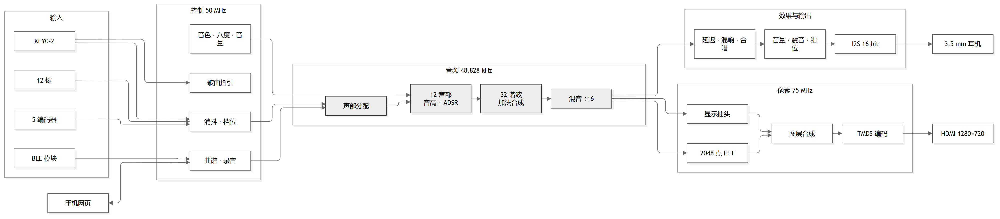
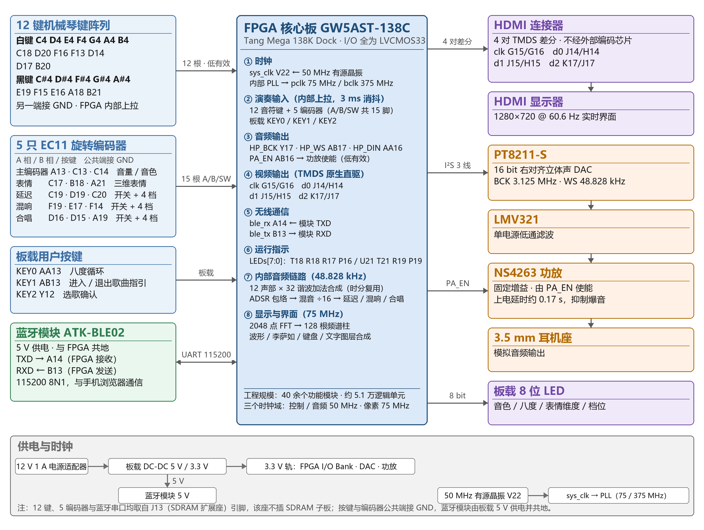

# 音符律动 · NoteMotion

> 一台完全由 FPGA 实时合成的多音色电子琴：12 键机械琴键、12 路复音、32 路谐波加法合成、HDMI 实时可视化，全部用纯 RTL 实现，不含 CPU 或软核。





## 项目简介

音符律动以高云 GW5AST-138C（Sipeed Tang Mega 138K Dock）为核心，从按键到扬声器的整条音频链、以及 HDMI 显示链，全部由 Verilog HDL 描述并在 FPGA 内部实时运行：

- 每个声部的 32 路谐波由一套**时分复用加法合成引擎**逐样本累加；
- 12 路声部（8 键盘 + 4 曲谱）在 **48.828 kHz** 采样率下并行发声，每秒约 **1250 万次**谐波运算；
- 从琴键动作到扬声器出声的端到端延迟约 **3.02–3.06 ms**（消抖窗口 3.000 ms 已由仿真核验）；
- 所有声音均由相位累加实时生成，**不播放任何预录 PCM 音频**。

## 功能特性

| 分类 | 内容 |
|---|---|
| 演奏 | 12 键机械琴键（7 白键 + 5 黑键），8 声部复音，第 9 键起按分配顺序抢占最早声部；KEY0 单键循环切换八度 |
| 音色 | 钢琴 / 管风琴 / 长笛 / 弦乐，各自独立的 32 项谐波系数与 ADSR 参数 |
| 表情 | 滑音（指数逼近）、颤音 5.96 Hz、震音 11.92 Hz，各四档深度 |
| 效果器 | 延迟 80/160/240/320 ms、混响四档、合唱四档，三路可独立开关并同时开启 |
| 可视化 | HDMI 1280×720@60.6 Hz：触发对齐示波器、李萨如图、2048 点 FFT 的 128 根频谱柱、键盘高亮、参数列与 GUIDE 面板 |
| 曲谱与录音 | 手机浏览器经蓝牙下发曲谱并自动演奏；演奏过程录制并回传为 MIDI；12 项键位在线映射 |
| 歌曲教学 | 内置《小星星》《欢乐颂》，8 颗 LED 提示目标键与拍点；进阶模式额外提供屏幕下落方块与命中判定 |
| 低延迟 | 硬件并行采样 + 3 ms 消抖，全链路无操作系统调度 |

## 硬件平台

| 部件 | 型号 / 说明 |
|---|---|
| FPGA 开发板 | Sipeed Tang Mega 138K Dock（GW5AST-138C，50 MHz 有源晶振） |
| 演奏输入 | 12 颗直插机械按键（面包板）+ 5 只 EC11 旋转编码器 + 板载 KEY0/1/2 |
| 音频输出 | PT8211-S（16 bit 右对齐 I²S）→ LMV321 低通 → NS4263 功放 → 3.5 mm |
| 显示 | 板载 HDMI 差分对，原生 TMDS 直驱，不经编码芯片 |
| 无线 | ATK-BLE02（ATK-MW579D）蓝牙透传，115200 8N1 |
| 外壳与琴键 | 3D 打印，模型见 `hardware/` |

引脚全部在 `fpga/src/top.cst` 中显式声明，统一 LVCMOS33。注意：

- 12 键、5 只编码器与蓝牙串口都取自 J13（SDRAM 扩展座）引脚，**该座不能插 SDRAM 子板**；
- `LEDs[4..7]` 是 CPU/SSPI 双功能脚，Gowin 工程里必须勾选 **Use SSPI/CPU as regular IO**，否则布线会报 `PR2017`；
- 蓝牙模块 VCC 用 3.3 V，TXD/RXD 必须为 3.3 V 电平。

## 目录结构

```
NoteMotion/
├─ fpga/                 高云工程（可直接打开）
│  ├─ fpga_gowin_project.gprj
│  └─ src/               79 个文件：RTL 源码 + top.cst + top.sdc
├─ tools/                Python 工具：MIDI→曲谱、协议帧、串口调试、AT 配置
├─ web/                  ble_piano.html（单文件手机端，Web Bluetooth）
├─ hardware/             3D 打印件（7 个 STL）
├─ docs/                 作品文档 PDF、蓝牙协议说明、引脚分配
└─ images/               框图源文件（Mermaid）+ 高分辨率 PNG 渲染图
```

## 快速开始

### 1. 打开并编译工程

1. 安装 Gowin EDA（本工程使用 V1.9.11.03）；
2. 打开 `fpga/fpga_gowin_project.gprj`；
3. Project → Configuration → **Place & Route**，把 `CPU` 与 `SSPI` 设为 `true`（即"Use SSPI/CPU as regular IO"）；
4. Synthesize → Place & Route → Programmer 烧录 `impl/pnr/*.fs`。

> 仓库不包含位流文件。综合一次约 13 分钟、布局布线约 36 分钟；布局对本工程比较敏感，若 HDMI 无输出，重新跑一次布局布线通常即可恢复。

### 2. 手机端（可选）

`web/ble_piano.html` 是单文件网页，通过 Web Bluetooth 与 FPGA 通信：下发 `.sps` 曲谱、一键播放、按键位映射修改、录制并回传 MIDI。

浏览器要求安全上下文（`https://` 或 `localhost`）。打开方式的详细步骤见 `docs/蓝牙曲谱下发_说明.md`。

## 关键指标

| 指标 | 数值 |
|---|---|
| 系统主时钟 / 音频采样率 | 50 MHz / 48.828 kHz（50 MHz ÷ 1024） |
| 复音结构 | 8 键盘 + 4 曲谱 = 12 路，每路 32 谐波 |
| 谐波吞吐 | 约 1250 万次/秒 |
| 按键到出声延迟 | 约 3.02–3.06 ms（消抖窗口 3.000 ms 经仿真核验） |
| 音频格式 | 16 bit 右对齐 I²S，BCK 3.125 MHz |
| 显示 | 1280×720 @ 60.6 Hz，像素时钟 75 MHz |
| 频谱 | 2048 点 FFT，128 根线性柱，0–16 kHz |
| 曲谱容量 | 8192 条事件，每条 8 字节 |
| 资源占用 | 逻辑 38%、寄存器 18%、BSRAM 39%、DSP 18% |

## 说明

- `docs/作品文档_音符律动.pdf` 是完整的作品文档，包含系统框图、模块流程、实测波形与设计取舍；
- 3D 打印件按真实钢琴键宽排布，装配关系见文档 2.2 节；
- 本仓库只包含源码、约束、工具、文档与图片，不包含位流、仿真测试台与视频。
